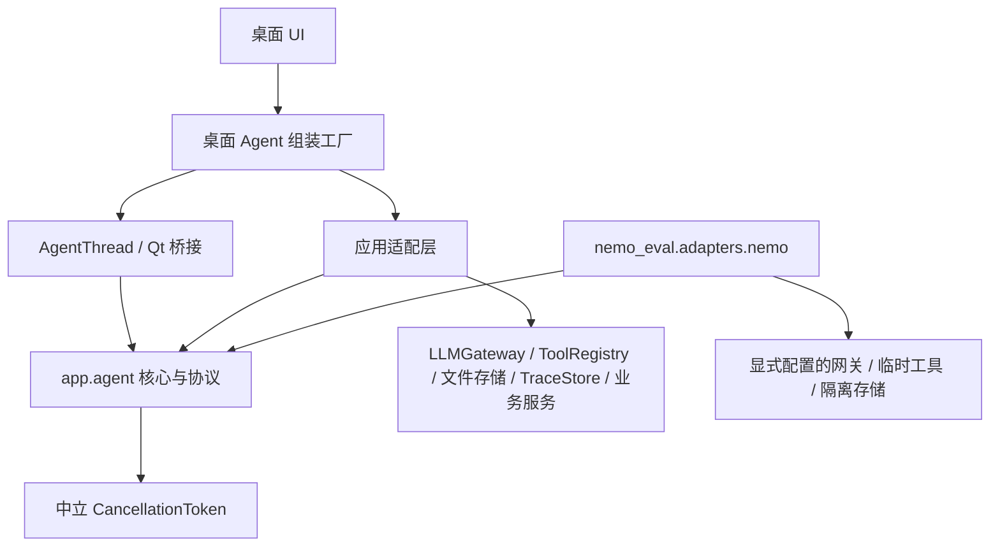

# Agent 核心解耦方案

> 状态：P1–P4 已实施，自动化验证记录见文末。日期：2026-11-14。
> 基线：`codex/bug-fixes`；第二节记录改造前状态，其余描述目标及实现。
> 范围：Agent 与模型、工具、持久化、业务 Hook、桌面组装之间的边界。

## 1. 判断与目标

解耦空间中等偏大，集中在依赖契约和应用组装，而非状态机重写。
当前 Agent 已经可以脱离 Qt 执行；不应把“还没抽成独立包”等同于“没有解耦”。

已实现目标：`app.agent` 成为只依赖标准库和中立运行时原语的执行核心。
桌面应用和独立评估器分别注入自己的模型、工具、存储及扩展。
后续只有出现独立版本、独立安装的实际需求，再考虑抽包。

收益是更换模型网关、工具实现、存储后端时无需修改循环，也能更容易证明评估运行与个人桌面数据隔离。
本次不引入新框架、异步重写、通用工作流引擎或插件发现系统。
参考 Pi 的模型层、循环层、应用层分工，保留 Nemo 已有的状态机、回调和 Hook。

## 2. 改造前实现与实际耦合

| 边界 | 现状与源码依据 | 判断 |
| --- | --- | --- |
| UI | [AgentThread](../../app/desktop/agent_thread.py) 将纯 Python 回调桥接到 Qt 信号 | 已有明确边界，保留 |
| 模型 | [AgentContext](../../app/agent/agent_context.py) 注入网关，但类型仍指向具体 `LLMGateway`；循环依赖 `chat_stream` 的字典约定 | 运行时可替换，需要显式协议 |
| 工具 | [Agent](../../app/agent/agent.py) 直接导入 `ToolRegistry`、`ToolErrorType`，读取工具实例的 `read_only`，调用静态结果格式化 | 核心仍绑定工具实现及其间接国际化依赖 |
| 执行上下文 | Agent 将 `_session_id` 写入模型给出的工具参数 | 业务上下文与模型参数混在一起 |
| checkpoint | `app/agent/checkpoint.py`（现已迁到[文件适配器](../../app/adapters/agent/checkpoint.py)） 使用应用路径；Agent 在未注入存储时回退到该实现 | 导入本身不做 IO，但运行时有隐式落盘位置 |
| Trace | Agent 接收可替换 `trace_store`，但直接调用一组无类型约束的存储方法 | 已可注入，需收敛契约，无须另建事件总线 |
| 业务 Hook | [agent_hooks](../../app/agent/agent_hooks.py) 同时包含机制、Message 转换和具体 `Consolidator` 类型检查；`app/agent/audit_hooks.py`（现已迁到[观测模块](../../app/observability/agent_hooks.py)） 依赖具体风险工具集合 | 机制与业务策略混放 |
| 组装 | [聊天控制器](../../app/ui/chat_session_controller.py) 创建 worker 并决定压缩、审计、观测 Hook | UI 同时承担应用运行配置 |
| 评估 | [Nemo adapter](../../evals/src/nemo_eval/adapters/nemo.py) 已注入脚本网关、工具注册器和隔离 checkpoint | 已有良好基础，应继续调用同一生产核心 |

改造前已支持无 Qt 运行；改造后增加了源码依赖检查与独立进程运行测试，禁止核心加载应用服务或访问个人配置、数据及日志目录。

## 3. 目标依赖方向

箭头表示导入或使用；适配层实现核心定义的协议。



已落地目录：

```text
app/agent/                     # 状态机、协议、数据类型、回调、通用 Hook 机制
app/runtime/cancellation.py    # 从 llm 层迁入的取消令牌，不导入桌面配置
app/adapters/agent/            # 模型、工具、checkpoint、Trace 的应用适配
app/conversation/agent_hooks.py # ConsolidatorHook 及 Message 转换
app/observability/agent_hooks.py # 审计、迭代观测 Hook
app/desktop/agent_factory.py   # 桌面依赖与扩展组装
app/desktop/agent_thread.py    # 仅线程与 Qt 信号适配
evals/src/nemo_eval/adapters/  # 评估侧显式组装；应用不反向导入
```

核心禁止导入 `app.ui`、`app.desktop`、`app.config`、`app.storage`、
`app.models`、`app.conversation`、`app.tools`、`app.llm`、`app.i18n`、
具体应用适配层和 `nemo_eval`，包括函数内及仅供类型检查的导入。
`app.agent.__init__` 也不得为便利导出而加载这些模块。

## 4. 需要明确的契约

使用标准库 `Protocol`、`TypedDict`、`dataclass`，无需新增依赖，也不要求具体服务继承核心基类。

| 协议/类型 | 最小能力 | 责任边界 |
| --- | --- | --- |
| `ModelStream` | `chat_stream(messages, tools, *, cancel_token, trace_id, seq)` | 产出既有归一化事件；路由、限流、重试、密钥和服务商协议留在网关 |
| `ToolRuntime` | `definitions()`、`describe(name)`、`execute(name, arguments, context)`、`format_result(result)` | 核心只看工具描述与标准结果，不拿到 `BuiltinTool` 实例 |
| `ToolDescriptor` | `name`、`read_only` | 控制既有只读批次并发；未知工具按串行处理，执行仍返回缺失错误 |
| `ToolExecutionContext` | `session_id`、`trace_id`、`call_id`、`cancel_token` | 与模型参数分开传递；不承诺正在执行的同步工具能强制中止 |
| `ToolResult` / `ToolFailureKind` | 保留 `status/data` 结构及错误类别 | 类别定义在核心契约；适配层映射注册器错误，未知类别沿用 runtime 处理 |
| `CheckpointStore` | `save(session_id, snapshot)`、`clear(session_id)` | 只保存恢复所需快照，不自动恢复或重跑副作用工具 |
| `TraceSink` | 既有 start、工具记录、状态记录、finish 方法 | 协议化当前能力，实际落库与脱敏留在适配层 |
| `AgentCallbacks`、`AgentHook` | 保留既有回调和裁决机制 | 不同时再引入订阅总线或第二套生命周期机制 |

### 4.1 模型与消息

先把现有网关归一化事件声明为类型联合：`text`、`tool_call`、`error`、`done`；
逐项核对实际被消费的字段，不在此轮重新设计服务商无关消息对象。
`messages` 保持现有字典结构，保留 `reasoning_content`、`provider_state`、
工具调用 `extra_content` 和多模态内容；业务 `Message` 与 API 字典之间的转换放在业务适配层。

核心只消费既有稳定字段，透传既有扩展字段。
新增服务商格式转换继续留在网关/providers；已有 `ProviderAdapter` 不并入 Agent 协议。
真实网关和脚本网关都通过相同契约测试，不能只依赖类型注解证明兼容。

### 4.2 工具执行

核心保留分批、并发、结果顺序、失败计数及终止规则；执行适配器继续调用原 `ToolRegistry.execute`。
参数转换、校验、禁用门禁、重试和结果截断/提示继续由原注册器负责，避免核心新增一遍重试。

适配器为每次调用复制参数，再把旧工具需要的 `_session_id` 注入执行副本；
模型原始参数、消息历史及传给 Hook 的参数不得被执行路径修改。
保留 call ID 与工具结果的关联，拒绝结果仍回灌模型，拒绝优先于放行。
`ToolCallView` 虽然是 frozen dataclass，内部字典目前仍可变；迁移时明确使用快照隔离，并覆盖嵌套参数。

### 4.3 默认存储与取消令牌

核心默认使用 `NullCheckpointStore`、`NullTraceSink`，不推导用户目录。
桌面工厂显式提供当前文件 checkpoint 与 Trace 适配器；评估只提供临时目录后端。
checkpoint 文件格式、恢复入口和现有会话兼容性先保持不变，由适配器转换新快照类型。
文件实现移出核心包，避免即使没有执行存储也静态依赖桌面路径。

当前 checkpoint 写入异常会向外传播；默认迁移保留该语义，不能直接吞掉。
Trace 写入异常继续隔离；关闭观测不影响工具执行门禁。

取消令牌实现迁到中立运行时模块，原 `app.llm.cancellation` 可单向重新导出兼容符号，
核心只导入新位置。保留资源注册/移除/关闭及线程安全语义，不只保留一个取消布尔值。

## 5. 业务扩展与运行组装

`agent_hooks.py` 仅保留上下文、裁决、组合机制。
将 `ConsolidatorHook` 和 Message 转换迁到 conversation，审计和迭代观测迁到 observability，
更新桌面及测试调用方，不让核心通过兼容导出重新引入业务依赖。

桌面工厂负责选择模型、工具、存储和业务扩展，每次运行创建独立上下文；
不引入全局服务定位器，不让核心或评估器隐式调用桌面工厂。
UI 仍负责构建本轮输入和展示，`AgentThread` 接收已组装的依赖并连接回调。
工厂不提前启动线程；保持 UI 连接信号后才启动 worker 的顺序。

安全策略与观测分别组装。当前默认 `SecurityAuditHook` 主要记录高风险调用，
并非完整权限系统；工具禁用门禁仍由注册器强制执行。
明确拒绝继续不执行工具，标记为强制策略的 Hook 异常必须拒绝调用；
审计写入失败仍可隔离。迁移应验证既有规则，若发现需改变安全行为，单独列为行为修复。

## 6. 分阶段实施

| 阶段 | 变更范围 | 验收与回退 |
| --- | --- | --- |
| P1：显式协议 | 核心类型、`ModelStream`、工具协议及注册器适配；替换具体工具导入 | 原状态机测试通过；新旧路径结果与调用顺序一致。单独提交，可整体回退该阶段 |
| P2：移除隐式依赖 | checkpoint/Trace 协议、空实现、文件适配器、取消令牌中立化 | 核心导入与运行均不访问个人数据；桌面仍显式使用原文件格式；验证读旧 checkpoint |
| P3：迁移业务 Hook | 移动压缩/审计/观测实现，隔离参数快照，更新内部导入 | 核心无业务反向依赖；压缩元数据、拒绝、Hook 异常与观测隔离测试通过 |
| P4：收敛组装 | 桌面工厂、Qt 壳、评估适配器和导入边界检查 | 桌面与评估调用同一核心；完整自动化检查通过；最小无界面运行示例可用 |

每阶段同步更新对应调用方，不保留两套 Agent 循环或长期双路径开关。
不改变现有会话、Trace、checkpoint 磁盘格式，尽量让回退只涉及代码。
本次已完成 P1–P4，继续保留单一 Agent 循环；尚未拆成独立安装包。

## 7. 验证与完成标准

优先扩展现有测试，新增测试围绕边界行为和兼容风险：

1. 导入检查同时扫描顶层、类型检查及函数内导入；用独立进程禁止加载桌面配置、keyring、业务存储后导入核心并完成脚本模型运行。
2. 工具适配与原注册器对照：禁用工具不执行、类型转换及校验一致、只重试 retry-safe 工具、结果格式及未知错误映射一致。
3. 运行回归：只读并发/写操作串行、工具结果保持调用顺序、软拒绝、致命错误、失败计数、max-turns 收尾与取消资源关闭。
4. 消息回归：多轮、压缩、工具反馈和返回历史保留服务商元数据与多模态内容；原参数不受 `_session_id` 注入或 Hook 嵌套修改污染。
5. 存储回归：空后端零业务落盘，文件后端读取旧 checkpoint，隔离后端不访问默认目录；checkpoint 失败与 Trace 失败分别符合既有语义。
6. 桌面/评估回归：Qt 回调桥接、取消与结束清理、关闭观测后的门禁，以及生产 Agent 离线评估场景均通过。

文档变更运行仓库检查；实现阶段完成相关测试后运行：

```powershell
uv run --extra desktop --extra dev --frozen python scripts/check_repo.py
uv run --extra desktop --extra dev --frozen pytest -q
uv run --project evals --extra dev --frozen pytest evals/tests -q
```

需要时使用 `QT_QPA_PLATFORM=offscreen`。自动化通过仅证明离线行为与接口兼容；
不代表真实模型质量或服务商联通已验证。结构迁移不默认触发有费用的模型评估。

完成标准：核心只向内依赖；桌面显式组装且原有功能保持；评估隔离可验证；
任一模型、工具或存储可用最小替身替换，无需修改状态机。

## 8. 主要风险与范围限制

- 类型包装如果丢弃扩展字段会破坏跨轮服务商协议，应优先保证无损透传。
- 存储默认值改变若漏接桌面工厂会让恢复能力静默消失，必须有真实文件适配集成测试。
- 将观测 Hook 当作权限系统会扩大安全承诺；保持现有注册器门禁和明确的策略异常语义。
- 同步工具的取消能力取决于具体实现，本方案不增加进程隔离、强制终止或 OS 沙箱。
- 独立发包、完整消息模型重构、async 化和更复杂调度均后置，以实际需求为依据。

相关边界遵循[安全模型](../en/security-model.md)；既有更广泛改造建议见
[代码库改造方案](current-codebase-improvement-plan.md)。本方案聚焦 Agent 依赖边界，不替代其中独立的问题修复。


## 9. 本次实现与验证

- 核心协议位于 [contracts.py](../../app/agent/contracts.py)；`AgentContext.registry` 字段保留原名，但现在接收 `ToolRuntime`，调用方需显式包装原注册器。
- 桌面使用 [create_agent_worker](../../app/desktop/agent_factory.py) 组装。`AgentThread` 接收独立上下文，保留连接信号后启动线程的顺序。
- 核心默认后端不落盘；桌面显式使用原会话目录，评估适配器显式使用隔离依赖。
- 原 `app.llm.cancellation` 重新导出同一个取消令牌类；内部业务 Hook 导入已更新到新位置。
- [边界测试](../../tests/test_agent_boundaries.py) 覆盖静态导入与受限独立进程；[适配测试](../../tests/test_agent_adapters.py) 覆盖原注册器行为、嵌套参数隔离、旧 checkpoint、写入失败和真实 Qt worker 信号桥接。
- 自动化测试只使用离线脚本、替身或 HTTP 模拟；未进行真实模型质量或服务商联通评估。

2026-11-14 验证结果：桌面全量测试 **1095 通过、9 跳过，12 个子测试通过**；
独立评估器测试 **118 通过**。仓库一致性检查、独立评估依赖边界检查及下述无界面示例均通过。

最小无界面示例见 [agent_headless.py](../../scripts/agent_headless.py)。在已同步依赖的环境中运行：

```powershell
uv run --no-sync python -m scripts.agent_headless
```

此示例仅验证核心接线，不请求模型、不启用工具，也不加载桌面服务或写入业务数据。
