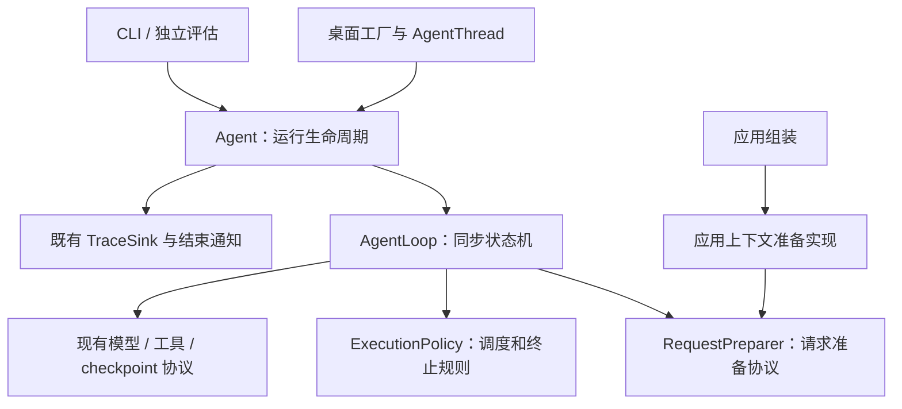

# Agent 第二阶段：循环、生命周期与请求上下文分离

> 状态：R1–R4 已实施，自动化验证记录见文末。日期：2026-11-14。
> 基线：`codex/bug-fixes`，提交 `e45a633`；仅依据已落地代码设计。
> 前置：[第一阶段依赖解耦](agent-core-decoupling.md)已完成。下文保留设计依据和验收范围。

## 1. 目标和适用边界

上一阶段已隔离 UI、工具实现及默认存储。这一阶段将 Agent 内部的运行生命周期、
状态机推进、模型请求准备和执行策略分开，降低后续修复或扩展时的相互影响。

参考 Pi 的职责划分，保留 Nemo 的应用形态：会话由应用管理，每次提交创建一次 Agent 运行；
桌面使用 QThread，无界面调用可同步执行或使用 Python 后台线程。
本轮继续使用既有 `ModelStream`、`ToolRuntime`、`CheckpointStore`、`TraceSink`，
不增加框架依赖、不拆独立包、不改成 async，也不建立第二套事件总线。

## 2. Pi 的参考点与本项目选择

参考来源为 2026-11-14 读取的
[Pi Agent README](https://github.com/earendil-works/pi/blob/main/packages/agent/README.md)、
[agent-loop.ts](https://github.com/earendil-works/pi/blob/main/packages/agent/src/agent-loop.ts)和
[types.ts](https://github.com/earendil-works/pi/blob/main/packages/agent/src/types.ts)。
本方案借鉴概念，不承诺与 Pi API 兼容，也不将其持续演进的能力当作 Nemo 已有能力。

| Pi 参考设计 | Nemo 采用方式 | 应用约束 |
| --- | --- | --- |
| 有状态 Agent 与底层循环分开 | `Agent` 管运行生命周期，`AgentLoop` 管同步状态机 | 不把会话数据库或长期历史搬进 Agent |
| `transformContext → convertToLlm` | 每次请求前，先整理上下文，再编码/校验模型消息 | 保留当前字典及网关协议，不引入另一套服务商消息系统 |
| 运行、回合、消息的生命周期明确 | 明确各回调时机，运行结束只通知一次 | 保留 `AgentCallbacks` 和 Qt 信号适配 |
| 可配置工具执行方式 | 独立执行策略对象 | 默认继续只读并发、写操作串行，不直接采用全部工具并行 |
| steering、follow-up 等输入调度 | 本轮仅保留原有注入边界 | 暂不增加打断工具、自动续跑或等待用户输入状态 |

## 3. 当前代码中需要解决的具体问题

| 现状 | 源码依据 | 影响 |
| --- | --- | --- |
| `Agent` 同时负责线程、状态机、工具批次、回调与请求构造 | [agent.py](../../app/agent/agent.py) | 修改其中一项通常需要理解整个类 |
| `_state_finalize` 和 `_run` 都调用结束回调 | 同上，两个结束路径 | 正常运行可能先通知不完整结果，再通知完整结果；UI 首次处理后已清理 worker |
| `is_running` 只检查内部线程；`run_sync` 未共用启动互斥 | 同上，`start/run_sync/is_running` | 同步执行中的状态不准确，混用入口缺少统一约束 |
| 工具定义读取在 `_run` 的异常保护之前 | 同上，`_run` 初始化 | 初始化异常可能绕过结果发布和等待者唤醒 |
| `before_turn` 仅在 PREPARE 调用一次 | 同上及 [agent_hooks.py](../../app/agent/agent_hooks.py) | 工具迭代后和强制收尾前没有统一的上下文准备步骤 |
| 压缩直接替换循环中的 messages | [ConsolidatorHook](../../app/conversation/agent_hooks.py) | 请求裁剪与运行历史混在一起；提高压缩频次可能影响结果历史及评估取证 |
| 评估通过原输入长度截取新增消息，并单独追加最终 answer | [Nemo 评估适配器](../../evals/src/nemo_eval/adapters/nemo.py) | 历史前缀被压缩后截取不可靠；统一历史时必须同时避免重复追加最终答复 |
| 并发数、失败阈值等在循环中写死 | [agent.py](../../app/agent/agent.py) | 难以单独测试策略或给不同运行入口提供明确配置 |

以上均为源码观察；本次编写方案没有运行缺陷复现测试，不将其描述为已修复。

## 4. 目标结构与责任分配



拟新增 `app/agent/agent_loop.py`、`request_context.py`、`execution_policy.py`；
`agent.py` 保留公开入口；`turn_context.py` 保留状态和单次运行的可变数据。
业务请求准备实现放在 `app/conversation/`，由桌面工厂显式注入。
新增模块继续接受现有导入边界检查，只依赖标准库、核心协议和中立运行时。

| 组件 | 负责 | 不承担 |
| --- | --- | --- |
| `Agent` | 启动互斥、运行标识、取消、等待、终态结果、最终通知和运行级 Trace | 状态处理和模型消息构造 |
| `AgentLoop` | 状态转换、迭代、工具批次、消息累积、checkpoint、迭代 Hook | 顶层线程创建、`wait()` 或再次启动自己 |
| `RequestPreparer` | 从历史快照生成本次模型请求视图 | 写会话数据库、修改权威历史、轮询输入队列 |
| `ExecutionPolicy` | 并发限制、失败计数规则、致命错误及轮数预算 | 工具权限授权、重试实现和存储路径 |
| `AgentThread` | 在一个 QThread 中调用 `Agent.run_sync()`，桥接回调 | 再调用 `Agent.start()` 产生第二层运行线程 |

低层循环保留工具批次所需的线程池。“同步循环”指不另建顶层运行线程，
不意味着把只读工具并发改成串行。现有状态图及转换表继续使用。

## 5. 生命周期与结果契约

### 5.1 一次运行的所有权

将 Agent 明确为一次运行的对象，状态为 `CREATED → RUNNING → SETTLING → FINISHED`。
`start()` 和 `run_sync()` 共用一次原子启动登记；重复或交叉启动抛出明确异常。
已完成或已取消的对象不重用；下一次提交构造新的上下文、取消令牌及 Agent。
这与当前桌面工厂和评估器每次构造新 Agent 的用法一致，但属于需要记录的 API 行为收紧。

调用 `start()` 时，先登记 RUNNING 再启动线程，消除创建线程与状态可见之间的空档。
线程启动失败也进入统一结算。`is_running` 覆盖 RUNNING 和 SETTLING，
不依赖 `threading.Thread` 是否存在，因此同步入口的状态同样准确。

取消是协作式请求：未开始执行也可取消；Qt 壳在内部 Agent 尚未创建时应取消已有上下文令牌。
等待已启动的同步工具返回后再完成结算，不宣称能强制中止该工具。
取消后的对象不再调用模型或启动后续工具；已开始的只读并发批次按现有边界收集结果。

### 5.2 只保留一个结束出口

`AgentLoop.run(...)` 返回终态数据，不触发 `on_done`；FINALIZE 只整理状态。
`Agent` 包住包括工具定义读取、上下文准备在内的完整执行过程，通过一个结算函数：

1. 固化 `status/ok/answer/messages/error/trace_id/trace` 和最终 Trace，生成不可被回调污染的结果快照。
2. 发布 `agent.result`，只调用一次 `on_done`；回调拿到独立快照，含完整结果和最终状态轨迹。
3. 无论普通执行异常或回调异常，都在清理路径标记 FINISHED、唤醒等待者。

`ok` 仅在 `status == "ok"` 时为真；取消保持 `status="cancelled"`。
初始化失败可返回空轨迹，但必须返回错误并结束等待。Trace 失败继续隔离；checkpoint 失败继续中止运行。

其他线程的 `wait(timeout)` 在结算完成后返回同一份结果值；超时返回 None。
执行线程不得等待自身：在结束回调中读取已发布的 `result`；对该线程调用 `wait()` 应明确拒绝，避免自锁。
结束回调期间禁止重新启动同一个对象。以上保证针对普通 Python 异常，不承诺进程强制退出后的通知。

Qt 的 `done` 仍在 `run_sync()` 返回前发出，`QThread.finished` 仍表示线程已结束。
保持 [聊天控制器](../../app/ui/chat_session_controller.py)的 worker 身份检查、取消显示和清理顺序；
跨线程 Qt 槽何时实际处理由 Qt 队列决定，核心不等待 GUI 槽完成。

### 5.3 现有通知机制的收敛

文本、工具、状态及消息元数据仍走 `AgentCallbacks`，迭代观察仍走现有 Hook。
明确一次请求对应一次迭代结束通知；请求准备失败也要提供带错误的迭代快照。
保留不同语义的迭代通知和运行结束通知，不新增与回调并行的订阅系统。
`on_need_input/supply_input` 当前没有完整消费流程；保留兼容入口，不把它表述为已实现的人工恢复能力。

## 6. 每次请求前的上下文管线

### 6.1 权威历史与请求视图区分

`run_history` 保留输入快照及本次产生的消息；请求裁剪不删除它的前缀。
`request_view` 只包含本次发送给模型的消息，可摘要或裁剪旧上下文。
二者不共享可变嵌套结构；审计、checkpoint 和结果取证以权威历史及原始工具结果为依据。

正常完成的 assistant 消息包含最终纯文本答复，工具调用和工具结果按 call ID 关联。
改造前 `result.messages` 并不总含终末 assistant，而评估另行追加 `answer`：
将完整消息写入权威历史是本阶段的显式行为调整，必须同步更新评估适配器，停止无条件追加 answer。
外部结果字段名及磁盘 schema 保留，`answer` 继续提供最终正文的便捷访问。
不能把本轮尚未闭合、被取消或失败的工具调用组当作正常完整组；不自动重放，也不把未执行记录标记为成功。

### 6.2 一个准备接口，两个清晰阶段

通过核心 `RequestPreparer.prepare(request)` 返回 `PreparedRequest(messages, tools)`。
输入包含独立历史快照、`session_id/trace_id/seq`、`normal/wrap_up` 模式及取消令牌；
应用实现内部顺序执行：

```text
权威历史快照 → transform_context（压缩/裁剪）
             → encode_for_model（现有消息格式转换与校验）
             → ModelStream.chat_stream
```

默认准备器是无副作用的复制和必要校验，无界面运行不隐式加载业务服务。
`encode_for_model` 保留当前网关输入结构，服务商转换继续由网关/providers 负责；
不强制全项目引入新的 AgentMessage 类型，也不重复注入系统提示、记忆和时间提示。
这些应用输入仍由现有 Prompt Builder 构建。

每次正常模型请求和 WRAP_UP 请求均经过同一入口，进入网关前再次检查取消。
WRAP_UP 强制 `tools=None`，准备器不能重新启用工具。
现有输入队列仍只在反馈边界消费；准备阶段不增加新的 steering/follow-up 轮询时机。

原 `before_turn` 按“单次运行开始”保留一次调用，不静默改成每次模型请求都调用。
其返回值用于初始请求视图，不再覆盖权威历史；这也是必须记录和测试的语义调整。
将压缩从该 Hook 迁入请求准备器，避免同一压缩器在两个位置重复运行。

### 6.3 压缩器需要一起适配

当前 Consolidator 会调用摘要模型并写入记忆，不能简单在每次请求前无条件重跑。
请求准备器为每次 Agent 运行维护摘要视图及已覆盖的历史前缀，
通过前缀摘要指纹复用已有结果；只在新增内容再次越过阈值时生成新摘要和归档。
同一个源前缀不重复摘要或重复写入记忆，不把跨会话缓存做成全局状态。

固定系统指令、最近用户输入以及必须保留的服务商状态不得被当作普通旧消息裁掉。
保留的工具调用/结果必须按完整组处理；尚未完成的当前工具组不得被压缩拆散。
保留 `reasoning_content`、`provider_state`、`extra_content` 和多模态内容的有效对应关系；
无法安全转换或预算仍不足时返回明确准备错误，不把损坏的协议历史发给模型。

摘要失败沿用可用的 raw fallback，但 fallback 同样必须满足消息完整性检查；
无法保持完整性则终止本次请求，不回退到可能超限或格式错误的原始请求。
摘要网关调用应传递取消令牌、在归档前检查取消，并保留既有独立调用观测；
不得归档未完成摘要，也不把摘要调用计作一轮主 Agent 工具迭代。

## 7. 执行策略的边界

使用不可变的具体配置/规则对象 `ExecutionPolicy`，先不设计通用策略插件体系。
默认值保持当前行为：只读批次最多 4 并发、同一工具失败计数阈值 5、
工具缺失和权限错误中止、达到原轮数上限后只进行一次无工具收尾请求。
`max_turns` 保留现有计数语义，初次提取不顺便重定义边界或失败计数方式。

策略可判断批次与错误后的下一步；失败计数、当前轮数等可变数据属于单次 Loop 状态。
未知工具仍按串行调度，实际执行由工具运行时返回缺失错误。
写操作形成串行屏障，批次结果按模型声明顺序进入历史，完成事件可按实际完成顺序发出。

参数转换、校验、禁用门禁、retry-safe 重试及格式化继续由工具适配器/注册器负责。
策略不提供绕过权限的开关，不把只读、可重试、可并行或可重放视为同一个属性。
原 `max_turns` 参数映射到唯一的有效策略，避免构造参数与策略中出现两份冲突配置。

## 8. 迁移顺序与验收

| 阶段 | 交付 | 关键验收 |
| --- | --- | --- |
| R1：生命周期收敛 | 原实现中先统一启动登记、结果结算和 `on_done` | 正常、错误、取消、空输入、初始化失败均只通知一次；等待可靠；同步状态正确；重复启动被拒绝 |
| R2：提取同步 Loop | 状态处理迁到 `AgentLoop`，Agent 保留公开运行入口 | Qt 不嵌套启动运行线程；仅一套循环；原状态、工具顺序、门禁、Trace/checkpoint 行为不变 |
| R3：请求准备与历史 | 权威历史、请求视图、准备器、压缩适配、评估迁移 | 每次请求含收尾均经过准备；压缩不改输入前缀；最终答复不丢失、不重复；无损协议与取消测试通过 |
| R4：策略提取 | 显式默认策略，桌面和评估分别组装 | 默认行为与原边界一致；配置不会绕过执行门禁；完整自动化与依赖边界检查通过 |

建议逐阶段形成聚焦提交；结构搬迁与行为调整分开验证，不保留长期双循环或双事件机制。
R1 的单次运行限制、R3 的历史补齐及 Hook 返回值语义需要写入开发说明，
同步迁移仓库调用方和有价值的现有测试，不维护直接调用旧私有状态处理方法的兼容壳。
回退以完整阶段为单位，尤其 R3 要连同压缩和评估适配一起回退；本方案不引入磁盘 schema 迁移。

## 9. 验证计划与完成标准

重点测试行为而非文件拆分或方法数量：

- 生命周期覆盖入口竞争、结束通知次数与完整载荷、回调异常、启动失败、同步状态、超时与取消前置窗口。
- 比较 Loop 与公开 Agent 的脚本模型轨迹；忽略 trace ID、时间等非确定字段，比较状态顺序、工具调用及终态。
- 请求准备计数区分主 Agent 请求与摘要调用；覆盖首轮、多工具轮和 WRAP_UP，确保收尾始终禁用工具。
- 让脚本模型在工具反馈后触发压缩，验证原输入/工具参数不变、评估新增消息完整、最终答复只保存一次。
- 覆盖摘要缓存与归档次数、摘要中取消、fallback 失败、完整工具组、服务商扩展字段、多模态及系统指令保留。
- 复用既有真实 Qt worker、文件 checkpoint 兼容、Trace 异常隔离、工具门禁与 retry-safe 测试。
- 扩展核心源码及受限独立进程检查；独立评估不得加载个人配置、keyring 或业务数据库。

实现阶段按改动先跑相关测试，再完成：

```powershell
uv run --extra desktop --extra dev --frozen python scripts/check_repo.py
uv run --extra desktop --extra dev --frozen pytest -q
uv run --project evals --extra dev --frozen pytest evals/tests -q
uv run --project evals --extra dev --frozen python evals/check_boundaries.py
uv run --no-sync python -m scripts.agent_headless
```

无显示环境按需设置 `QT_QPA_PLATFORM=offscreen`。实际执行记录见下节。
离线测试不代表真实模型质量或服务商联通验证；本轮不要求付费模型评估。

完成标准：Agent 只有一个运行结束出口；Loop 可同步独立执行；每次主模型请求通过准备管线；
压缩不改变权威历史；策略可独立验证；桌面与评估保留同一生产核心且没有第二套存储或会话所有权。

安全和运行边界继续遵循[安全模型](../en/security-model.md)。
OS 沙箱、强制中断同步工具、工具自动重放、完整人工恢复、async 化及 Pi 式多队列调度均在本轮范围之外。

## 10. 实施与验证记录

2026-11-14，已完成 R1–R4：

- [Agent](../../app/agent/agent.py) 仅管理单次运行登记、启动、取消、结果发布和结束通知；[AgentLoop](../../app/agent/agent_loop.py) 负责同步状态机，保留只读工具线程池。
- [请求契约](../../app/agent/request_context.py) 在每次请求前检查消息关联并复制协议字段；[桌面压缩准备器](../../app/conversation/request_preparer.py) 维护运行内缓存，按被摘要源内容指纹去重摘要与归档。缓存视图随历史新增消息延伸，再次越阈值才重新摘要。
- 固定保留系统/开发者指令、最近用户输入与最新完整工具组；其余消息按完整组选择。预算计入工具 schema 和服务商扩展字段；图片成本仍是文本近似，不宣称供应商精确 token 计算。必留内容超出压缩预算时明确失败。
- [执行策略](../../app/agent/execution_policy.py) 由桌面工厂和评估适配器显式组装；注册器门禁与重试继续保留。工具结果按声明顺序进入历史，致命并发错误也保留同批已完成结果。
- Qt 继续使用 `run_sync()`，支持 Agent 创建前取消；评估器直接持久化生成的完整 assistant 消息，不再次追加答复。旧 Hook 只调整请求视图；兼容压缩 Hook 保留给旧调用方，桌面不再使用。

验证结果：桌面全量测试 **1138 通过、9 跳过，12 个子测试通过**；独立评估器 **118 通过**。
仓库一致性检查、独立评估依赖边界检查、无界面示例及 `git diff --check` 均通过。
测试覆盖启动竞争、启动/初始化失败、恰好一次通知、结果隔离、同步状态、等待与取消、准备失败、
收尾禁用工具、缓存及归档去重、压缩后历史、协议扩展、多模态和可配置执行边界。
仅运行离线自动化；未运行付费真实模型评估，也未构建发布二进制。
